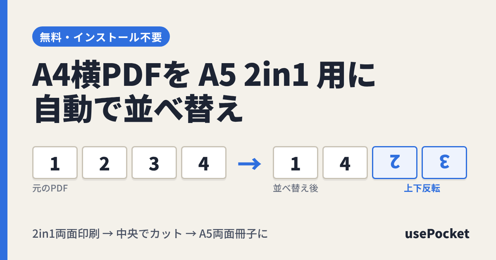

# A4→A5 両面冊子 並べ替えツール（a4toa5-2in1）

A4横向きのPDFを、**A4用紙に2in1で両面印刷 → 紙の中央で切る** だけで A5 の両面冊子になる順番に並べ替える Web ツールです。

- 先頭から4ページずつ **1 → 4 → 2 → 3** の順に並べ替え
- 各組の **2ページ目と3ページ目を上下反転（180°回転）**
- ページ数が4の倍数でないときは白紙を足してそろえる（末尾にそのまま付ける設定も可）
- 処理はすべてブラウザ内で完結（PDFはサーバーに送信しない）



## 冊子になるしくみ

| A4用紙 | 上半分 | 下半分 |
|---|---|---|
| 表 | 1 | 4 |
| 裏 | 2（反転） | 3（反転） |

中央で切ると「表1／裏2」と「表4／裏3」の2枚になり、重ねると1〜4ページの順に読めます。
両面印刷のとじ方向（長辺／短辺）はプリンターによって結果が変わるので、最初に1枚試し刷りしてください。

## ファイル構成

| ファイル | 内容 |
|---|---|
| `index.html` | 配布用の説明ページ（アクセスカウンター、OGPタグ付き） |
| `app.html` | ツール本体（[pdf-lib](https://pdf-lib.js.org/) を CDN から読み込み） |
| `counter.cgi` | アクセスカウンター（Perl CGI、JSONを返す） |
| `ogp.png` | SNSでリンクを共有したときの代表画像（1200×630） |

## 設置方法（さくら・ロリポップなどのレンタルサーバー）

1. ファイル一式を公開フォルダ（例: `https://usepocket.com/a4toa5-2in1/`）にアップロード
2. `counter.cgi` のパーミッションを **755**（ロリポップは 700 でも可）に設定
   - 改行コードは LF のままアップロードしてください
   - カウント数は同じフォルダの `counter.dat` に自動で保存されます（初回アクセス時に作成）
3. 設置先URLが `https://usepocket.com/a4toa5-2in1/` と違う場合は、`index.html` と `app.html` の
   `og:url` / `og:image` / `twitter:image` / `canonical` のURLを書き換えてください（OGP画像は絶対URLが必要です）

CGIが動かない環境（GitHub Pages など）では、カウンターは自動で非表示になり、ツール自体はそのまま使えます。

### counter.cgi の使い方

```
counter.cgi        → 現在の数を返す（数えない）
counter.cgi?inc=1  → 1増やしてから返す
返り値: {"total":123,"today":4}
```

説明ページは同じタブ内での再読み込みを二重に数えません（sessionStorage を使用）。

## 開発元

[usePocket](https://usepocket.com)
