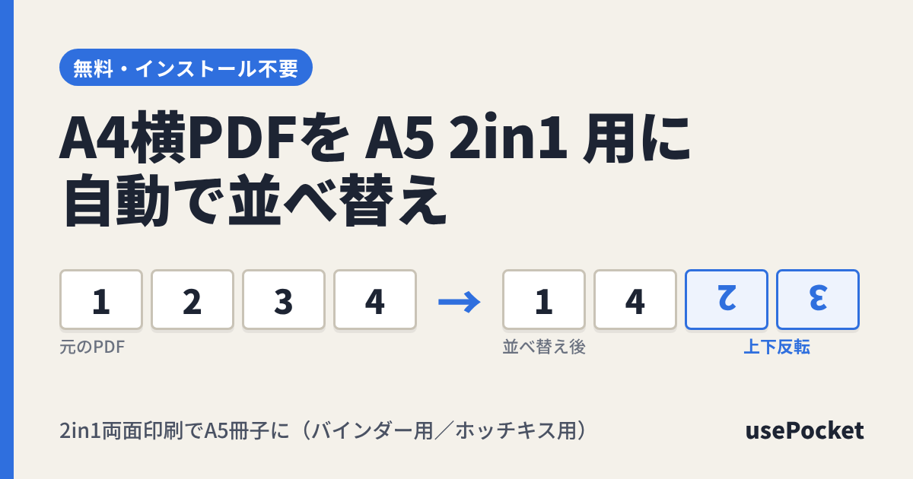

# A4→A5 両面冊子 並べ替えツール（a4toa5-2in1）

A4横向きのPDFを、**A4用紙に2in1で両面印刷** するだけで A5 の両面冊子になる順番に並べ替える Web ツールです。
2つの作り方から選べます。

| 作り方 | 並び順（4ページごと） | 上下反転 | 仕上げ |
|---|---|---|---|
| **2つ穴バインダー等用** | 1 → 4 → 2 → 3 | 元の2・3ページ目 | 紙の中央で切って重ね、穴をあけてとじる |
| **切断無しホッチキス留め用** | 4 → 1 → 3 → 2 | 元の2・3ページ目 | 切らずに二つ折りにして重ね、ホッチキスで留める |

- ページ数が4の倍数でないときは白紙を足してそろえる（末尾にそのまま付ける設定も可）
- 並び順・反転ページは手動で変更することも可能
- 処理はすべてブラウザ内で完結（PDFはサーバーに送信しない）
- `app.html#binder` / `app.html#staple` で作り方を指定して開ける



## 冊子になるしくみ

### 2つ穴バインダー等用（1→4→2→3）

| A4用紙 | 上半分 | 下半分 |
|---|---|---|
| 表 | 1 | 4 |
| 裏 | 2（反転） | 3（反転） |

中央で切ると「表1／裏2」と「表4／裏3」の2枚になり、重ねると1〜4ページの順に読めます。

### 切断無しホッチキス留め用（4→1→3→2）

| A4用紙 | 上半分 | 下半分 |
|---|---|---|
| 表 | 4 | 1 |
| 裏 | 3（反転） | 2（反転） |

1ページ目が外側になるよう中央で二つ折りにすると、表紙1・中面2と3・裏表紙4になります。折った紙を順に重ねて折り目側をホッチキスで留めます。

両面印刷のとじ方向（長辺／短辺）はプリンターによって結果が変わるので、最初に1枚試し刷りしてください。

## ファイル構成

| ファイル | 内容 |
|---|---|
| `index.html` | 配布用の説明ページ（アクセスカウンター、OGPタグ付き） |
| `app.html` | ツール本体（[pdf-lib](https://pdf-lib.js.org/) を CDN から読み込み） |
| `ogp.png` | SNSでリンクを共有したときの代表画像（1200×630） |

## 設置

- 設置先: https://fetuin.moo.jp/a4toa5-2in1/
- 上の3ファイルを公開フォルダにアップロードするだけで動きます（CGI不要）。
- 設置先URLを変える場合は、`index.html` と `app.html` の `og:url` / `og:image` / `twitter:image` / `canonical` を書き換えてください（OGP画像は絶対URLが必要です）。

### アクセスカウンター

usePocket の汎用カウンター `https://usepocket.com/api/counter.cgi` をページタグ `a4toa5-2in1` で使っています。

```
counter.cgi?page=a4toa5-2in1            → 1回数えてJSONを返す（同じIPの1時間以内の再訪は数えない）
counter.cgi?page=a4toa5-2in1&mode=view  → 数えずに現在の値を返す
```

説明ページは、同じタブでの再読み込みでは `mode=view` で値だけ取得します。カウンターに接続できないときは表示しません。

## 開発元

[usePocket](https://usepocket.com)
